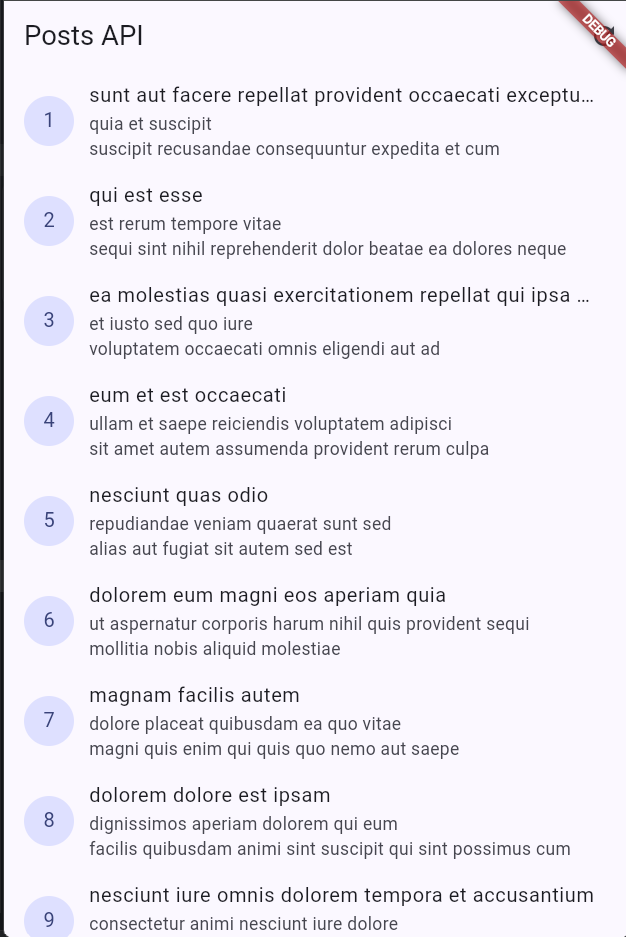
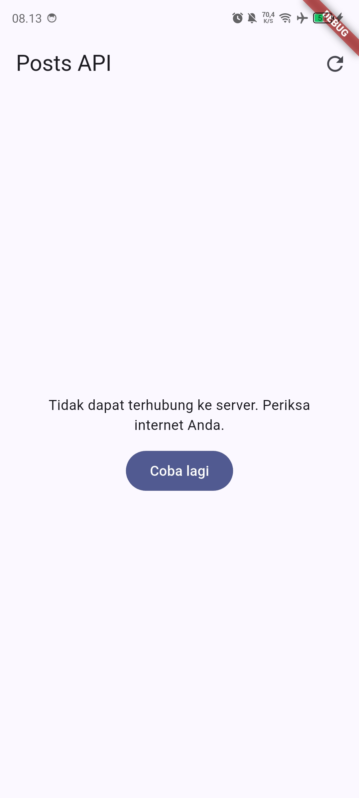
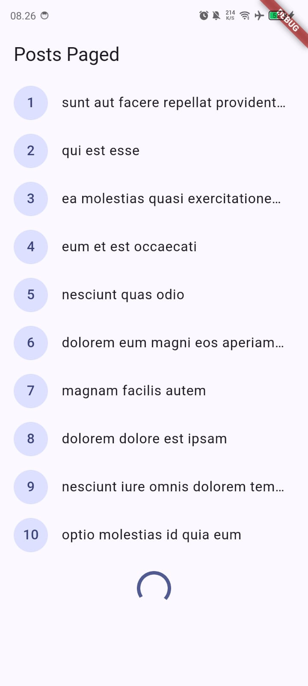

# Laporan Praktikum Minggu 4: Networking & REST API
> **Mata Kuliah:** Pemrograman Mobile | **Semester:** Genap 2025/2026

---

### Identitas Mahasiswa
| Data | Keterangan |
| :--- | :--- |
| **Nama Lengkap** | Muchammad Ibrahim Al Amin |
| **NIM** | 244107020062 |
| **Kelas** | TI-3F |
| **Program Studi** | D-IV Teknik Informatika |
| **Jurusan** | Teknologi Informasi |
| **Institusi** | Politeknik Negeri Malang |

---

## Praktikum 1: Fetch REST API dengan Dio + Riverpod

Mengambil 100 posts dari JSONPlaceholder (`GET /posts`) melalui `Dio` terpusat (`lib/data/api_client.dart`, timeout 10 detik) dan menampilkannya lewat `AsyncNotifierProvider` (`lib/data/providers.dart`). Saat internet normal, UI melewati fase loading (spinner) lalu me-render daftar.

### Tangkapan Layar Hasil Praktikum
| Daftar 100 Posts Berhasil Dimuat |
| :---: |
|  |
| *ListTile berisi judul + body post dengan CircleAvatar ID; data dari `PostRepository.fetchPosts()`* |

---

## Praktikum 2: Error Handling Ramah + Retry

Dua skenario kegagalan diuji: (1) internet dimatikan (mode pesawat) lalu tekan refresh, dan (2) `baseUrl` sementara diganti URL salah. Keduanya dipetakan oleh `friendlyErrorMessage()` menjadi pesan Bahasa Indonesia beserta tombol **Coba lagi** (`ref.invalidate` / `refresh()`), bukan stacktrace mentah.

### Tangkapan Layar Hasil Praktikum
| Internet Mati (Mode Pesawat) + Refresh | `baseUrl` Salah (Simulasi Koneksi Gagal) |
| :---: | :---: |
|  |  |
| *Pesan "Tidak dapat terhubung ke server" + tombol Coba lagi; nyalakan internet lalu tekan Coba lagi* | *Pesan koneksi yang sama tampil; kembalikan `baseUrl` setelah uji* |

---

## Praktikum 3: Pagination Infinite Scroll

`home` di `main.dart` diganti menjadi `PagedPostPage`, yang memuat posts per halaman (`GET /posts?_page=&_limit=10` via `PostRepository.fetchPostsPage`). Scroll mendekati bawah memicu `loadNextPage()`: halaman 1 tampil dulu, indikator loading muncul di ujung list, data baru ditambahkan tanpa reload penuh.

### Tangkapan Layar Hasil Praktikum
| Pagination Berjalan (Data Bertambah Saat Scroll) |
| :---: |
|  |
| *Halaman 1 tampil dulu, spinner bawah saat memuat halaman berikut, item menumpuk via `PagedPostsNotifier`* |

---

## AI Prompt Challenge

```text
Buatkan repository layer Flutter untuk endpoint GET /comments?postId={id}
dari JSONPlaceholder menggunakan Dio + flutter_riverpod.
Requirements:
- Model Comment dengan fromJson aman null (postId, id, name, email, body).
- CommentRepository dengan method fetchComments(postId) + timeout 10 detik.
- AsyncNotifierProvider dengan penanganan error otomatis (AsyncError)
  dan fungsi pesan error ramah pengguna untuk timeout, connection error,
  404, dan 500.
- Satu unit test untuk fromJson dengan field yang hilang.
Jelaskan setiap bagian kode dalam komentar.
```

### Hasil AI Prompt Challenge
| Berkas Hasil | Peran |
| :--- | :--- |
| `lib/data/models/comment.dart` | Model `Comment` + `fromJson` aman-null (`as num? ?? 0`, `as String? ?? ''`) |
| `lib/data/repositories/comment_repository.dart` | `fetchComments(postId)` → `GET /comments?postId` + `.timeout(10 detik)` |
| `lib/data/comment_providers.dart` | `commentListProvider` (family per-`postId`) + `commentErrorMessage()` untuk 4 error wajib |
| `test/comment_test.dart` | 7 test: `fromJson` field hilang, 5 pemetaan error, 1 repository mock |

---

## Refactoring Challenge

### Poin-Poin Refactoring Kode
Dalam rangka meningkatkan kualitas dan keterbacaan kode (*clean code*), sejumlah refactoring dilakukan:
1. **Pemisahan Repository Layer (`PostRepository` / `CommentRepository`)**:
   - Logika network (`Dio.get`, query parameters, timeout) dipindah dari widget ke `lib/data/repositories/`.
   - Repository menerima `Dio` via constructor (dependency injection) sehingga mudah di-mock tanpa HTTP sungguhan.
2. **Pemisahan Provider Komentar (`comment_providers.dart`)**:
   - Provider Dio, repository, dan `AsyncNotifier` komentar dipindah ke berkas tersendiri agar `providers.dart` milik Post tidak tercemar.
   - Menggunakan pola Riverpod 3 non-generator: `extends AsyncNotifier` + constructor menyimpan arg family.
3. **Sentralisasi Pesan Error Ramah**:
   - `friendlyErrorMessage()` (Post) dan `commentErrorMessage()` (Comment, eksplisit 500) menerjemahkan `DioExceptionType` menjadi Bahasa Indonesia.
   - Menangani juga `TimeoutException` Dart murni dari `.timeout()`.
4. **Kepatuhan Standar Linter (`flutter analyze`)**:
   - Pengujian kode statis menghasilkan **No issues found!** (0 warnings).
   - Hasil eksekusi (08 Okt 2026):
   ```text
   Analyzing week4_api...
   No issues found! (ran in 9.2s)
   ```

---

## Pengujian Kode (Testing)

### Strategi Pengujian yang Diterapkan
Pengujian otomatis diterapkan pada dua tingkatan penting:
1. **Unit Testing Model (`test/comment_test.dart` → fromJson)**:
   - Menguji `Comment.fromJson` dengan field yang hilang agar menghasilkan default aman (`0` / `''`) tanpa throw.
   - Menguji `commentErrorMessage()` memetakan timeout, connection error, 404, 500, dan `TimeoutException` ke pesan ramah.
2. **Unit Testing Repository (mock Dio)**:
   - Memverifikasi `fetchComments(1)` mengirim path `/comments` + query `postId: 1` via interceptor mock.
   - Memastikan item rusak (bukan map) dibuang `whereType` dan item parsial jadi default aman.

Hasil pengujian: **7/7 test lolos** (`flutter test test/comment_test.dart` → **All tests passed!**).
Hasil eksekusi (08 Okt 2026):
```text
00:00 +0: Comment.fromJson aman null saat field hilang
00:00 +1: commentErrorMessage memetakan 4 error wajib timeout -> pesan lambat/timeout
00:00 +2: commentErrorMessage memetakan 4 error wajib connection error -> pesan tidak dapat terhubung
00:00 +3: commentErrorMessage memetakan 4 error wajib 404 -> pesan tidak ditemukan
00:00 +4: commentErrorMessage memetakan 4 error wajib 500 -> pesan gangguan server
00:00 +5: commentErrorMessage memetakan 4 error wajib TimeoutException Dart murni -> pesan timeout
00:00 +6: fetchComments mem-parsing list dan mengirim postId
00:00 +7: All tests passed!
```
Hasil `flutter test` penuh: **+11 -1** — satu-satunya yang gagal adalah `test/widget_test.dart: Counter increments smoke test`.
Catatan: `test/widget_test.dart` bawaan template (counter) gagal karena aplikasi kini menampilkan `PagedPostPage`, bukan counter — tidak terkait perubahan minggu ini.

---

## Checklist Verifikasi Praktikum

- [x] **Fetch REST API**: `GET /posts` via Dio tampil sebagai daftar 100 posts setelah loading.
- [x] **Error Handling Ramah**: Offline dan `baseUrl` salah menampilkan pesan Indonesia + tombol Coba lagi.
- [x] **Pagination**: `PagedPostPage` memuat per 10 item, indikator bawah, data menumpuk tanpa reload penuh.
- [x] **Repository Layer AI**: `Comment` aman-null, `fetchComments(postId)` + timeout 10 detik, provider family + 4 pesan error, unit test field hilang.
- [x] **Kualitas Kode**: Lolos `flutter analyze` dengan 0 peringatan dan `flutter test test/comment_test.dart` 7/7 lolos.
- [x] **Eksplorasi AI**: Hasil interaksi AI diverifikasi, disesuaikan, dan didokumentasikan dengan baik.

---

## Eksplorasi AI Prompt Challenge

Dokumentasi rinci menyatu dalam laporan ini (tidak ada berkas `docs/` terpisah pada minggu ini); kode hasil ada pada `lib/data/models/comment.dart`, `lib/data/repositories/comment_repository.dart`, `lib/data/comment_providers.dart`, dan `test/comment_test.dart`.

### Prompt yang Digunakan
```text
Buatkan repository layer Flutter untuk endpoint GET /comments?postId={id}
dari JSONPlaceholder menggunakan Dio + flutter_riverpod.
Requirements:
- Model Comment dengan fromJson aman null (postId, id, name, email, body).
- CommentRepository dengan method fetchComments(postId) + timeout 10 detik.
- AsyncNotifierProvider dengan penanganan error otomatis (AsyncError)
  dan fungsi pesan error ramah pengguna untuk timeout, connection error,
  404, dan 500.
- Satu unit test untuk fromJson dengan field yang hilang.
Jelaskan setiap bagian kode dalam komentar.
```

### AI Verification Checklist (Temuan & Analisis)

| No | Poin Pemeriksaan dari Instruktur | Hasil Evaluasi | Analisis Temuan & Tindakan Perbaikan |
| :-: | :--- | :-: | :--- |
| **1** | **Apakah `fromJson` aman null** (field hilang tidak crash)? | **Lolos** | Menggunakan `(json['x'] as num?)?.toInt() ?? 0` dan `json['x'] as String? ?? ''`, mengikuti pola `Post.fromJson`. Terbukti oleh test field hilang. |
| **2** | **Apakah `fetchComments(postId)` memakai query benar + timeout 10 detik?** | **Lolos** | Mengirim `queryParameters: {'postId': postId}` ke `/comments` dan membungkus dengan `.timeout(Duration(seconds: 10))`, di atas `connectTimeout`/`receiveTimeout` di `createDio()`. Terbukti oleh test mock Dio. |
| **3** | **Apakah error otomatis jadi `AsyncError` + 4 pesan ramah** (timeout, connection error, 404, 500)? | **Lolos** | `build()` async melempar exception → Riverpod menjadikannya `AsyncError` tanpa try-catch. `commentErrorMessage()` memetakan keempatnya (500 pesan khusus), plus `TimeoutException` Dart. Terbukti 5 test pemetaan. |
| **4** | **Apakah ada unit test `fromJson` field hilang?** | **Lolos** | `test('Comment.fromJson aman null saat field hilang')` — JSON hanya berisi `name`, sisanya default aman, tidak throw. |
| **5** | **Apakah kode AI memakai API Riverpod versi lama/keliru** (family salah, retry menggantung)? | **Diperbaiki** | Draf awal memakai `FamilyAsyncNotifier` yang tidak ada (`ref`/`state` undefined). Diperbaiki ke pola Riverpod 3 non-generator (`extends AsyncNotifier` + constructor arg + `AsyncNotifierProvider.family`) dan `retry: null` agar error final saat di-test. |
| **6** | **Jalankan `flutter analyze` dan `flutter test`, apakah hasil AI lolos tanpa warning?** | **Lolos** | `flutter analyze` → **No issues found!**; `flutter test test/comment_test.dart` → **7/7 All tests passed!** (widget_test bawaan gagal pre-existing, di luar cakupan). |

---

## Refleksi

### 1. Mengapa UI dilarang memanggil Dio langsung? Apa yang rusak jika aturan ini dilanggar?

**Alasan Mengapa UI Dilarang Memanggil Dio Langsung:**
* **Separation of Concerns (Pemisahan Tanggung Jawab):** Lapisan UI (Widget) hanya bertugas untuk menyajikan data dan menangani interaksi pengguna (*presentation logic*). Detail teknis HTTP (URL endpoint, header, query parameter, timeout, dan serialisasi JSON) adalah tanggung jawab *Repository/Data Layer*.
* **Abstraksi Sumber Data:** UI seharusnya tidak peduli dari mana data diambil—apakah dari Dio (REST API), cache lokal, SQLite/Hive, atau data tiruan (*mock*). UI hanya mengonsumsi state (`AsyncValue`).

**Hal yang Rusak / Terganggu Jika Aturan Ini Dilanggar:**
1. **Pengujian Kode Menjadi Sangat Sulit (*Untestable UI*):** Widget tidak dapat diuji secara terisolasi tanpa koneksi internet atau tanpa membuat mock HTTP client yang sangat rumit di level widget. Dengan adanya Repository Layer, repository dapat di-mock dengan mudah via constructor injection atau provider override saat pengujian.
2. **Keterikatan yang Terlalu Erat (*Tight Coupling*):** Widget menjadi terikat mati dengan library `Dio`. Jika di kemudian hari arsitektur beralih ke library HTTP lain, GraphQL, atau Firebase, seluruh berkas tampilan UI harus dibongkar dan diubah.
3. **Duplikasi Kode (*Code Duplication*):** Jika beberapa halaman/widget membutuhkan data yang sama, konfigurasi Dio, penanganan timeout, header otentikasi, dan parsing JSON akan terduplikasi di banyak tempat.
4. **State Management & Caching Kacau (*Redundant Network Calls*):** Memanggil Dio langsung di dalam lifecycle widget (seperti `initState` atau `build`) berisiko memicu request jaringan berulang setiap kali widget melakukan *rebuild*, menghamburkan kuota pengguna, membebani server, serta berisiko *memory leak* jika widget di-*dispose* sebelum request selesai.
5. **Penanganan Error Terfragmentasi:** Penanganan exception (`DioException`, error timeout, HTTP 404/500) harus ditulis berulang kali dengan blok `try-catch` di setiap widget, membuat antarmuka rentan menampilkan pesan error yang tidak seragam bagi pengguna.

---

### 2. Kapan pagination client-side cukup, dan kapan harus mengandalkan pagination server (`_page` / `_limit`)?

* **Kapan Pagination Client-Side Cukup:**
  * **Volume Data Kecil & Terbatas:** Jumlah data relatif sedikit dan ukurannya dapat diprediksi (misalnya < 100–200 item, seperti daftar kategori produk, daftar opsi dropdown, atau pengaturan).
  * **Ukuran Payload Ringan:** Ukuran keseluruhan payload JSON sangat kecil (puluhan KB), sehingga proses pengunduhan sekaligus di awal tidak membebani memori maupun kuota pengguna.
  * **Kebutuhan Fitur Pencarian & Filter Lokal Instan:** Aplikasi membutuhkan fitur pencarian (*instant search*), penyaringan (*filter*), dan pengurutan (*sorting*) langsung di sisi perangkat tanpa jeda jaringan (*zero network latency*). Seluruh data disimpan di memori dan dipotong (*sliced*) per halaman tampilan secara instan.
  * **Data Jarang Berubah:** Data bersifat statis atau semi-statis yang tidak memerlukan sinkronisasi *real-time* ke server secara berkala.

* **Kapan Harus Mengandalkan Pagination Server (`_page` / `_limit`):**
  * **Volume Data Besar atau Terus Bertambah:** Dataset berskala ratusan, ribuan, hingga jutaan item (misalnya linimasa/feed media sosial, katalog e-commerce, riwayat transaksi, atau komentar).
  * **Optimalisasi Waktu Muat Awal (*Fast Initial Render / TTFB*):** Pengguna tidak perlu menunggu ribuan baris diunduh hanya untuk membaca beberapa baris pertama. Mengambil 10 item pertama membuat aplikasi tampil instan dalam hitungan milidetik.
  * **Efisiensi Memori (RAM) Perangkat Mobile:** Menyimpan dan me-render ribuan objek Dart secara bersamaan dapat memicu lag, penurunan FPS (*jank*), hingga *crash* akibat *Out-of-Memory* (OOM).
  * **Efisiensi Beban Server dan Basis Data:** Server hanya memproses query database sesuai kebutuhan (`LIMIT` & `OFFSET` atau kueri berbasis kursor), menghindari *full table scan* yang menguras sumber daya komputasi server.

---

### 3. Bagaimana exception repository berubah menjadi `AsyncError` tanpa try/catch di setiap widget? Kapan try/catch eksplisit tetap dibutuhkan?

* **Bagaimana Exception Berubah Menjadi `AsyncError` Tanpa `try/catch` di Setiap Widget:**
  * **Mekanisme *Error Boundary* Internal Riverpod:** Pada `AsyncNotifier` (atau `FutureProvider`), metode `build()` atau komputasi *asynchronous* dieksekusi di dalam blok penanganan internal Riverpod.
  * **Transformasi Otomatis ke `AsyncValue.error`:** Ketika repository melempar exception (misalnya `DioException` saat tidak ada koneksi internet atau `TimeoutException` saat server lambat), Riverpod secara otomatis menangkap (*catch*) exception tersebut beserta *stack trace*-nya. Riverpod lalu mengubah state notifier dari `AsyncLoading` menjadi `AsyncValue.error(error, stackTrace)`.
  * **Konsumsi Deklaratif Melalui Pattern Matching di UI:** Di sisi widget, kita cukup menggunakan `ref.watch(provider).when(data: ..., error: (err, stack) => ..., loading: ...)` secara deklaratif. Widget otomatis menampilkan UI error sesuai state tanpa perlu menulis blok `try-catch` manual di dalam method `build()`.

* **Kapan `try/catch` Eksplisit Tetap Dibutuhkan?**
  1. **Aksi Interaksi Pengguna Bersifat Imperatif (Mutasi Data / Event-Driven):** Saat pengguna memicu aksi tombol, misalnya menekan tombol *Submit*, *Hapus Post*, atau *Kirim Komentar* (`onPressed`). Jika method notifier dipanggil secara imperatif (`await ref.read(postNotifier.notifier).deletePost(id)`), kita memerlukan `try/catch` eksplisit pada fungsi *event handler* tersebut untuk menampilkan umpan balik sesaat seperti `SnackBar`, `AlertDialog`, atau *toast*.
  2. **Penanganan Error Parsial di Level Repository (*Resilient Parsing*):** Ketika mem-parsing sekumpulan item JSON dari API dan terdapat satu item dengan format korup/rusak. Blok `try/catch` lokal di dalam perulangan repository diperlukan agar item rusak tersebut bisa diabaikan atau diganti nilai default tanpa menggagalkan pemuatan seluruh daftar item.
  3. **Penerjemahan Error Menjadi Domain Exception (*Error Mapping*):** Ketika repository ingin menangkap error teknis tingkat rendah (`DioException`, `SocketException`) dan membungkusnya menjadi *custom domain exception* yang lebih bersih (seperti `NetworkFailure`, `ServerFailure`, `AuthFailure`) sebelum diteruskan ke lapisan provider/UI.

---

### 4. Bagian mana dari hasil AI yang Anda perbaiki, dan mengapa?

Berdasarkan pengujian dan validasi implementasi kode *Comment Repository Layer* yang direkomendasikan oleh AI, terdapat 4 aspek utama yang diperbaiki:

1. **Perbaikan API Riverpod Family (Kesesuaian Versi & Pola Non-Generator):**
   * *Temuan AI:* Kode awal yang diberikan AI mengasumsikan penggunaan `FamilyAsyncNotifier` (sintaks berbasis generator kode `riverpod_generator`), padahal proyek ini menggunakan Riverpod 3 murni (*non-generator*). Akibatnya terjadi *compile error* karena `ref` dan `state` tidak dikenali.
   * *Perbaikan:* Mengubahnya ke pola manual yang sesuai: kelas `CommentListNotifier extends AsyncNotifier<List<Comment>>` dengan konstruktor penerima argumen `this.postId`, lalu didaftarkan melalui `AsyncNotifierProvider.family`.
   * *Alasan:* Memastikan kode kompatibel dengan dependensi proyek saat ini dan dapat dikompilasi tanpa memerlukan *build runner*.

2. **Penonaktifan Percobaan Ulang Otomatis (*Auto-Retry*):**
   * *Temuan AI:* AI tidak menyetel parameter penanganan *retry*, sehingga Riverpod 3 secara *default* terus melakukan percobaan ulang saat terjadi error jaringan. Hal ini menyebabkan unit test menggantung (*hanging/timeout*) dan membebani server dengan request berulang.
   * *Perbaikan:* Menambahkan `retry: (retryCount, error) => null` pada definisi provider.
   * *Alasan:* Menjadikan status error bersifat final dan deterministik sehingga mudah diuji pada unit test dan tidak memicu *infinite loop* saat kondisi offline.

3. **Penyempurnaan Error Handling Ramah (Status HTTP 500 dan `TimeoutException` Dart):**
   * *Temuan AI:* AI hanya menyediakan pemetaan error umum dan melewatkan pesan spesifik untuk kode status HTTP 500, serta tidak menangani `TimeoutException` bawaan Dart yang dilempar oleh pemanggilan `.timeout(Duration(seconds: 10))` di level repository.
   * *Perbaikan:* Menambahkan percabangan kondisi untuk `statusCode == 500` ("Server sedang gangguan (500)") serta klausa `if (error is TimeoutException)` pada fungsi `commentErrorMessage()`.
   * *Alasan:* Menjamin seluruh 4 skenario kegagalan wajib (timeout, connection error, 404, 500) menampilkan pesan Bahasa Indonesia yang ramah dan mudah dipahami pengguna, bukan stack trace teknis mentah.

4. **Penerapan Alur Test-Driven Development (TDD):**
   * *Temuan AI:* Rekomendasi AI langsung memberikan kode jadi tanpa memastikan tahapan pengujian.
   * *Perbaikan:* Menerapkan siklus *Red-Green-Refactor*, yaitu menulis unit test `test/comment_test.dart` terlebih dahulu hingga gagal (*Red*), baru kemudian mengimplementasikan model dan repository hingga seluruh 7 unit test lulus (*Green*).
   * *Alasan:* Memastikan test benar-benar memvalidasi perilaku kode, bukan hanya sekadar lolos formalitas.

