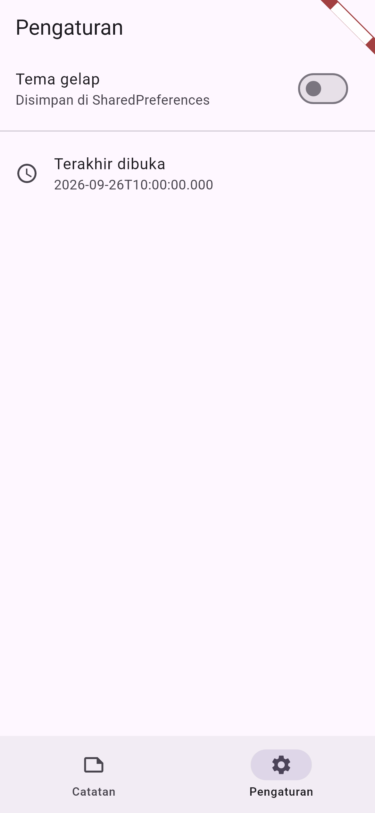
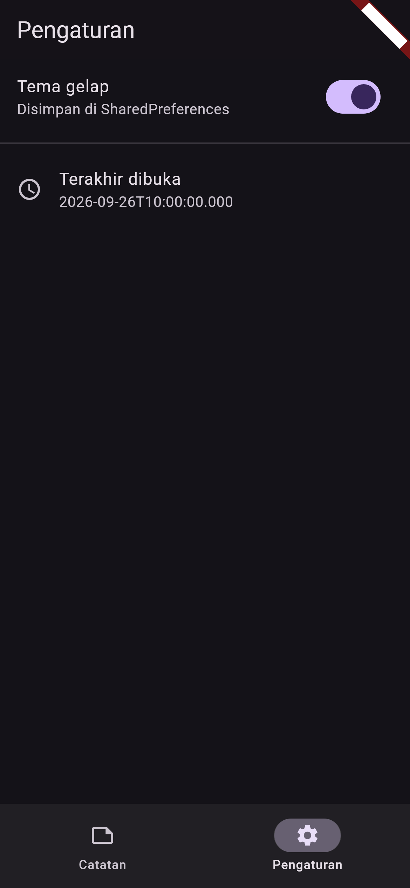
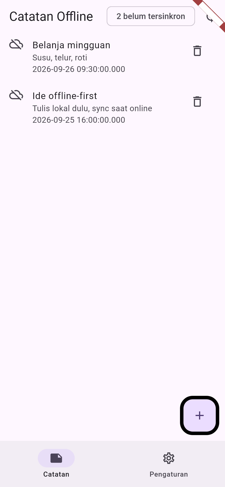
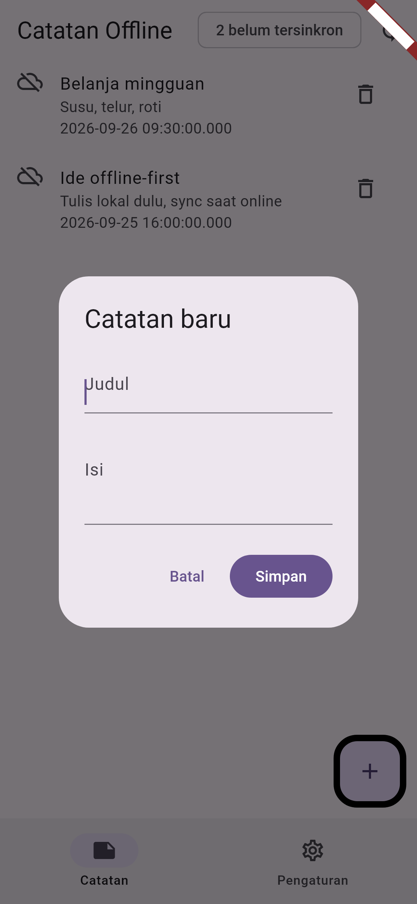
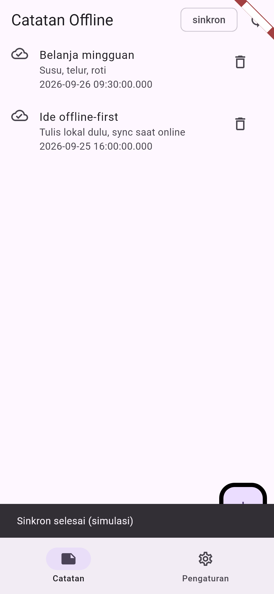
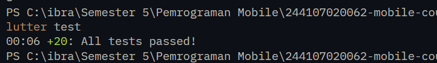

# Laporan Praktikum Minggu 5: Local Storage & Offline-First
> **Mata Kuliah:** Pemrograman Mobile | **Semester:** Genap 2025/2026

---

### Identitas Mahasiswa
| Data | Keterangan |
| :--- | :--- |
| **Nama Lengkap** | Muchammad Ibrahim Al Amin |
| **NIM** | 244107020062 |
| **Kelas** | TI-3F |
| **Program Studi** | D-IV Teknik Informatika |
| **Jurusan** | Teknologi Informasi |
| **Institusi** | Politeknik Negeri Malang |

Proyek: `week5_offline_notes/` — aplikasi Offline Notes (preferensi + CRUD SQLite + sync offline-first).

> Semua screenshot tampilan aplikasi di laporan ini adalah **mobile portrait** (golden 390x844 @3x). Enam capture langsung dari HP Infinix X6739 (1080x2400), termasuk dirty sebelum/sesudah sync, ada di `week5_offline_notes/screenshots/`.

---

## Praktikum 1: Preferensi Tema + Terakhir Dibuka (SharedPreferences)

Preferensi kecil key-value (tema gelap/terang, waktu terakhir dibuka) disimpan di `SharedPreferences` lewat `PrefsRepository` (`lib/data/prefs.dart`). UI tidak memanggil `SharedPreferences.getInstance()` langsung: tema lewat `darkModeProvider` (`AsyncNotifier` di `lib/pages/settings_page.dart`), waktu dibuka lewat `lastOpenedProvider` (`lib/main.dart`, ditulis sekali via `markOpenedNow()`).

### Tangkapan Layar Hasil Praktikum
| Pengaturan Tema Terang | Pengaturan Tema Gelap |
| :---: | :---: |
|  |  |
| *Toggle mati, tema terang; "Terakhir dibuka" persisten* | *Toggle menyala (ungu), seluruh layar bertema gelap; tersimpan di SharedPreferences* |

---

## Praktikum 2: CRUD Catatan SQLite (sqflite)

Koleksi catatan (mendukung 1000+) disimpan di SQLite via `sqflite`: skema `notes(id, title, body, updated_at, dirty)` + `cached_posts` (`lib/data/local/db.dart`), model `Note` (`lib/data/local/note.dart`), dan `NoteRepository` (`lib/data/repositories/note_repository.dart`) dengan `fetchNotes()` (`ORDER BY updated_at DESC`), `addNote()` (`dirty=1`), `updateNote()` (refresh `updatedAt` + `dirty=1`), `deleteNote()`, `countDirty()`, `markAllSynced()`. State dipegang `NotesNotifier`/`notesProvider` (`lib/data/notes_providers.dart`); halaman `NotesPage` (`lib/pages/notes_page.dart`) hanya memakai provider.

### Tangkapan Layar Hasil Praktikum
| Daftar Catatan (Urut Terbaru) | Dialog Tambah Catatan |
| :---: | :---: |
|  |  |
| *2 catatan urut `updated_at` DESC + badge dirty + FAB + navigasi bawah* | *Dialog "Catatan baru": Judul + Isi + Batal/Simpan; judul kosong ditolak* |

---

## Praktikum 3: Offline-First Sync (dirty flag + last-write-wins)

Setiap tulis lokal menandai `dirty=1`. Badge di AppBar (`dirtyCountProvider`, Chip `N belum tersinkron` / `sinkron`) menunjukkan antrean sync; tombol sync menjalankan `syncNotes()` (`lib/data/sync.dart`, simulasi delay 1 detik lalu `markAllSynced()`). Aturan konflik: **last-write-wins berdasarkan `updated_at`** (rincian: `week5_offline_notes/docs/aturan-konflik.md`).

### Tangkapan Layar Hasil Praktikum
| Sebelum Sync (2 Belum Tersinkron) | Sesudah Sync (Sinkron) |
| :---: | :---: |
|  |  |
| *Chip "2 belum tersinkron", ikon awan-off di tiap baris* | *Chip "sinkron", ikon awan-centang + SnackBar "Sinkron selesai (simulasi)"* |

Bukti tambahan dari HP asli (Infinix X6739, 1080x2400) untuk alur yang sama — mode pesawat ON, tambah 2 catatan, lalu sync:

| HP: Sebelum Sync (Mode Pesawat) | HP: Sesudah Sync |
| :---: | :---: |
|  |  |
| *Badge "2 belum tersinkron", ikon awan-off, status bar mode pesawat* | *Badge "sinkron", ikon awan-centang, SnackBar "Sinkron selesai (simulasi)"* |

---

## AI Prompt Challenge

```text
Aplikasi Flutter Offline Notes: CRUD catatan + preferensi tema.
Bandingkan SharedPreferences, Hive, sqflite (SQLite), dan Drift
untuk dua kebutuhan ini. Requirements:
- Kriteria: kompleksitas query, kebutuhan relasi, reaktivitas (stream),
  type-safety, ukuran boilerplate, dan kemudahan testing.
- Beri rekomendasi final: mana untuk preferensi, mana untuk catatan,
  beserta alasannya dalam 1 tabel.
- Tunjukkan skema tabel/kotak untuk 1000+ catatan.
Jelaskan trade-off setiap pilihan.
```

### Hasil AI Prompt Challenge
| Kebutuhan | Pilihan | Alasan |
| :--- | :--- | :--- |
| Preferensi (tema, terakhir dibuka) | SharedPreferences | Key-value kecil, API simpel, cukup |
| Catatan (CRUD 1000+) | sqflite (SQLite) | Query + sorting `updated_at` + `dirty flag` untuk sync; boilerplate sepadan |

Bukti: `week5_offline_notes/docs/perbandingan-storage.md` (tabel 4 storage + skema + indeks `idx_notes_updated`), `docs/keputusan-final.md` (AI verification checklist), `docs/AI_PROMPT.md` (prompt asli).

---

## Refactoring Challenge

### Poin-Poin Refactoring Kode
1. **Ekstraksi sync (`lib/data/sync.dart`)**: `syncNotes()` dipindah dari rencana inline di UI menjadi fungsi data-layer (delay 1 detik + `markAllSynced()`), terdokumentasi aturan last-write-wins-nya.
2. **Pemisahan provider (`lib/data/notes_providers.dart`)**: `noteRepositoryProvider`, `NotesNotifier`/`notesProvider` (`retry: null` agar error final saat di-test, pola Week 4), `dirtyCountProvider` (dihitung dari list agar auto-refresh), plus helper testing `readNotesOnce`/`readNotesErrorOnce` dan `friendlyDbError()`.
3. **Perbaikan circular dependency (bug nyata, tertangkap golden test)**: `add/update/delete/sync()` semula memanggil `ref.invalidate(dirtyCountProvider)` — padahal `dirtyCountProvider` me-`watch` `notesProvider`, sehingga Riverpod melempar `CircularDependencyError` saat tombol sync ditekan. Perbaikan: hapus invalidate manual (dirty otomatis rebuild via `watch`), plus regression test `NotesNotifier.sync tanpa circular dependency, dirty 0`.
4. **Repository bisa di-injeksi**: `NoteRepository({openDb})` + `updateNote()` baru, sehingga unit test memakai fake in-memory tanpa SQLite asli.
5. **Entrypoint render dev-only (`lib/screenshot_main.dart`)**: override `noteRepositoryProvider` dengan seed in-memory untuk kebutuhan render screenshot laporan.
6. **Kepatuhan linter (`flutter analyze`)**: **No issues found!**

---

## Pengujian Kode (Testing)

1. **Unit + provider (`test/note_test.dart`, 12 test)**: roundtrip `toMap`/`fromMap`, default field hilang, `addNote` → `dirty=1`, order `updated_at DESC`, `updateNote`, `deleteNote`, `syncNotes` 2→0 dan 0→0, provider sukses/error via fake, `dirtyCountProvider`, regression sync tanpa circular.
2. **Widget (`test/widget_test.dart`, 2 test)**: tab + daftar dari repository palsu, FAB membuka dialog (mock SharedPreferences).
3. **Golden screenshot (`test/screenshot_test.dart`, 6 test)**: render 390x844 @3x font Roboto/MaterialIcons asli, data deterministik; juga berfungsi sebagai regression visual.

Hasil: **20/20 test lolos** (`flutter test` → **All tests passed!**).

| Hasil Eksekusi `flutter test` |
| :---: |
|  |

Hasil `flutter analyze`:
```text
Analyzing week5_offline_notes...
No issues found! (ran in 43.7s)
```

---

## Eksplorasi AI Prompt Challenge

Dokumentasi rinci: `week5_offline_notes/docs/perbandingan-storage.md`, `docs/keputusan-final.md`, `docs/aturan-konflik.md`.

### AI Verification Checklist (Temuan & Analisis)

| No | Poin Pemeriksaan | Hasil Evaluasi | Analisis Temuan & Tindakan Perbaikan |
| :-: | :--- | :-: | :--- |
| **1** | **Apakah daftar catatan di SharedPreferences?** | **Ditolak** | Koleksi = SQLite (`note_repository.dart`). Satu string JSON di prefs rapuh/lambat untuk query dan update parsial. |
| **2** | **Apakah skema mendukung antrean sync?** | **Lolos** | Kolom `dirty` + `updated_at`, `countDirty()`, `markAllSynced()`, `syncNotes()` ada dan diuji. |
| **3** | **Apakah klaim "real-time" didukung stream?** | **Ditolak sebagian** | sqflite polos tanpa stream; dipakai `invalidate` provider (cukup untuk codelab). Klaim real-time butuh Drift `watch()` atau Stream wrapper. |
| **4** | **Apakah estimasi boilerplate masuk akal?** | **Lolos** | `flutter_riverpod + shared_preferences + sqflite + path` + skema `db.dart` sesuai estimasi; `version: 1`, tanpa migrasi rumit. |
| **5** | **Apakah `dirtyCountProvider` + sync bebas circular?** | **Diperbaiki** | Draf awal invalidate manual → `CircularDependencyError` saat sync (tertangkap golden test). Diperbaiki: andalkan `watch` reaktif + regression test. |
| **6** | **Apakah `flutter analyze` + `flutter test` lolos?** | **Lolos** | `No issues found!`; 20/20 **All tests passed!** |

---

## Refleksi Pembelajaran

### 1. Mengapa preferensi di SharedPreferences, tetapi koleksi catatan di SQLite?
Preferensi adalah pasangan key-value kecil yang dibaca-tulis utuh (tema, timestamp) — SharedPreferences simpel dan cukup. Koleksi 1000+ catatan butuh query (`ORDER BY updated_at DESC`), update parsial per baris, dan flag sync — hanya SQLite yang menyediakannya tanpa memuat seluruh koleksi ke memori. Satu string JSON di prefs untuk 1000 catatan berarti setiap tambah/edit harus parse + tulis ulang semuanya: lambat dan rapuh.

### 2. Apa gunanya `dirty flag` + `updated_at` (last-write-wins)?
`dirty=1` menandai baris yang berubah sejak sync terakhir sehingga sync hanya mengunggah yang perlu (hemat kuota, idempoten). `updated_at` menyelesaikan konflik dua-arah: bila baris berubah di dua tempat, versi dengan timestamp terbaru menang — sederhana, deterministik, dan terdokumentasi di `aturan-konflik.md`. Tanpa keduanya, sync dua arah menimpa data diam-diam.

### 3. Mengapa UI dilarang memanggil SQLite/SharedPreferences langsung?
Agar UI tetap deklaratif dan teruji: widget hanya `watch` provider. Repository yang di-injeksi (`{openDb}`, provider override) memungkinkan seluruh 20 test berjalan tanpa HP maupun internet, termasuk golden screenshot. Pelanggaran aturan ini membuat widget tidak bisa diuji terisolasi dan menduplikasi logika query di banyak halaman.

### 4. Bagian mana dari hasil AI yang Anda perbaiki, dan mengapa?
1. **Real-time → invalidate:** AI menyiratkan reaktivitas stream; sqflite tidak memilikinya — dipakai `invalidateSelf()` + `watch` (jujur didokumentasikan di `keputusan-final.md`).
2. **Circular dependency:** pola invalidate manual dari draf AI meledak saat sync; diperbaiki menjadi reaktif murni + regression test.
3. **Test deterministik:** timestamp `DateTime.now()` membuat golden flaky — diperbaiki dengan seed + fake prefs bertanggal tetap (`2026-09-26T10:00:00.000`).
4. **FontLoader ByteData:** `buffer.asByteData()` tanpa batas membuat engine hang; diperbaiki dengan `ByteData.sublistView()`.

---

## Cara Menjalankan Aplikasi
1. Arahkan terminal ke folder proyek:
   ```bash
   cd 05-week-5-local-storage-offline-first/week5_offline_notes
   ```
2. Pasang dependensi:
   ```bash
   flutter pub get
   ```
3. Jalankan di HP/emulator (disarankan untuk SharedPreferences/sqflite):
   ```bash
   flutter run
   ```
4. Verifikasi:
   ```bash
   flutter analyze
   flutter test
   ```
