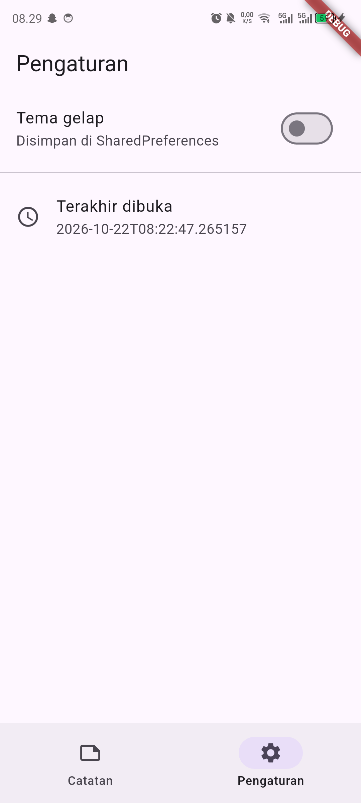
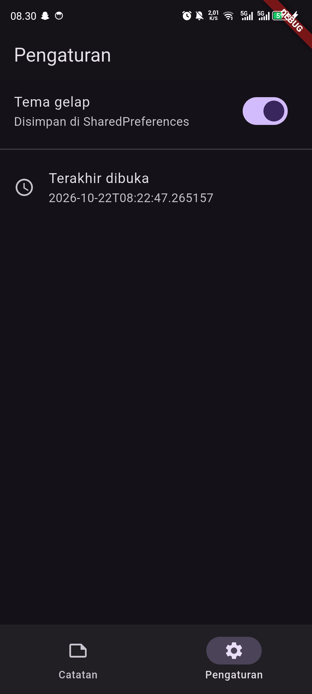
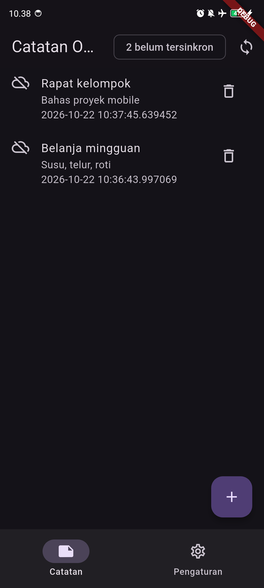
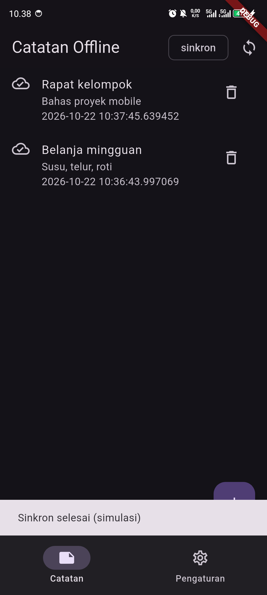

# Screenshots — Week 5 (Mobile)

Screenshot di folder ini diambil langsung dari HP **Infinix X6739 (Android 14)** saat aplikasi berjalan dalam mode debug. Semua gambar berformat portrait **1080x2400** dan menunjukkan tampilan mobile, bukan desktop/web.

| File | Isi | Status praktikum |
|---|---|---|
| `01-notes-list.png` | Tab Catatan, state kosong ("Belum ada catatan. Tambah lewat tombol +"), tombol `sinkron`, dan FAB | Bukti UI daftar catatan (state kosong) |
| `02-settings-terang.png` | Tab Pengaturan tema terang + "Terakhir dibuka" | Memenuhi (toggle tema + persistensi SharedPreferences) |
| `03-settings-gelap.png` | Tab Pengaturan tema gelap (switch ON) | Memenuhi (persistensi tema) |
| `04-offline-mode.png` | Tab Catatan saat mode pesawat ON; UI tetap tampil dari state lokal SQLite | Bukti parsial offline-first: UI tetap berjalan tanpa network |
| `05-dirty-sebelum.png` | Dua catatan dibuat saat mode pesawat ON; badge **2 belum tersinkron** dan ikon awan-off di tiap baris | Bukti antrean sync dari HP |
| `06-dirty-sesudah.png` | Mode pesawat OFF lalu tekan `sinkron`; badge **sinkron**, ikon awan-centang, dan SnackBar "Sinkron selesai (simulasi)" | Bukti `markAllSynced()` dari HP |

Screenshot laporan utama (daftar berisi 2 catatan, dialog tambah, dirty sebelum/sesudah sync) ada di `../Screenshot/` — golden test **390x844 @3x** yang juga portrait mobile. Folder ini menyimpan capture HP asli untuk alur yang sama, termasuk bukti mode pesawat dan SnackBar sync.

## Galeri mobile

| Catatan (kosong) | Pengaturan terang |
| :---: | :---: |
|  |  |
| **Pengaturan gelap** | **Mode pesawat (offline)** |
|  |  |
| **Sebelum sync (mode pesawat)** | **Sesudah sync** |
|  |  |

Cara ambil di HP:
1. Sambungkan HP, jalankan `flutter run` (debug).
2. Tab Catatan kosong → `01`; tab Pengaturan tema terang/gelap → `02`/`03`.
3. Mode pesawat ON → buka tab Catatan → `04`.
4. Masih mode pesawat, tambah 2 catatan → badge `2 belum tersinkron` → `05`.
5. Mode pesawat OFF → tekan ikon sync di AppBar → badge `sinkron` + SnackBar → `06`.
