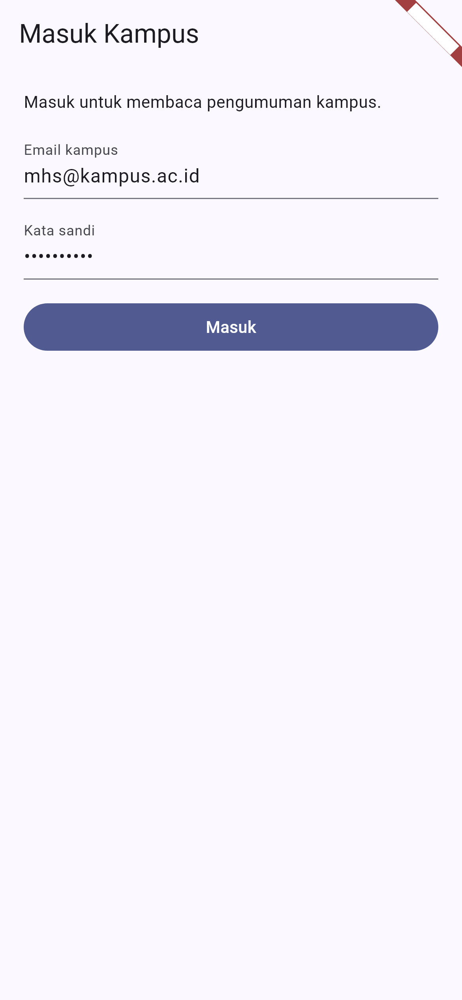
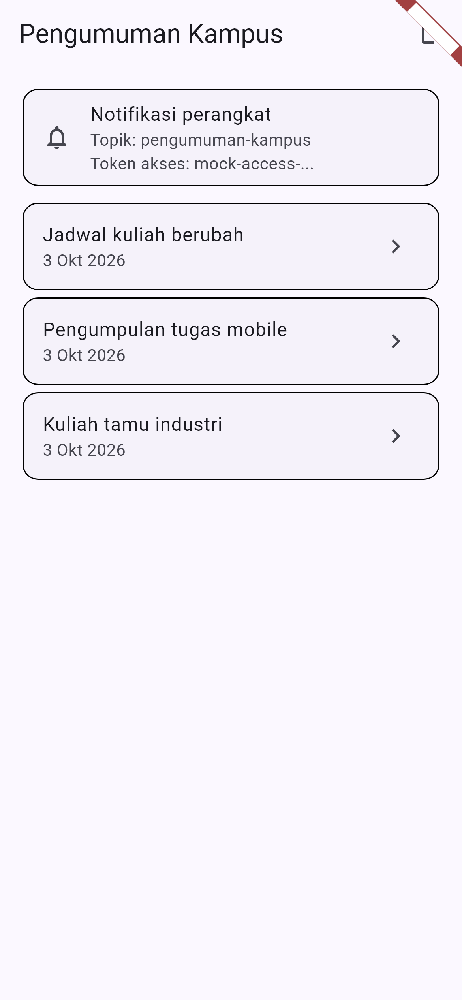
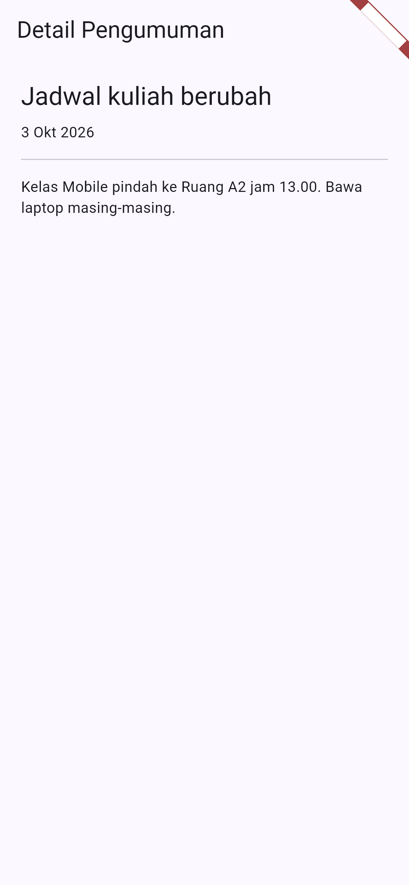

# Laporan Praktikum Minggu 6: Authentication, Security, FCM
> Mata Kuliah: Pemrograman Mobile | Semester: Genap 2025/2026

---

### Identitas Mahasiswa
| Data | Keterangan |
| :--- | :--- |
| Nama Lengkap | Muchammad Ibrahim Al Amin |
| NIM | 244107020062 |
| Kelas | TI-3F |
| Program Studi | D-IV Teknik Informatika |
| Jurusan | Teknologi Informasi |
| Institusi | Politeknik Negeri Malang |

Aplikasi Campus Notify adalah aplikasi pengumuman kampus dengan login. Proyek ada di folder campus_notify. Praktikum dikerjakan 3 Okt 2026.

---

## Praktikum 1: Login Mock dan Guard Route

Login memakai AuthRepository mock yang meniru JWT. Email valid dan sandi minimal 6 karakter menghasilkan access token dan refresh token. Guard route GoRouter mengarahkan pengguna belum login ke halaman login. Aturan guard ditulis sebagai fungsi murni authRedirect agar mudah diuji unit.

### Tangkapan Layar Hasil Praktikum
| Halaman Login |
| :---: |
|  |
| Form email dan sandi terisi, tombol Masuk siap ditekan |

---

## Praktikum 2: Token Aman dan Refresh Otomatis

Access token dan refresh token hanya tersimpan di secure storage lewat TokenStore. UI dan Dio tidak pernah menyentuh storage langsung. Saat server jawab 401, interceptor menukar refresh token dengan access token baru lalu mengulang request sekali saja. Bila refresh ikut mati, sesi dibersihkan dan pengguna kembali ke login. Layar debug hanya menampilkan 12 karakter pertama token.

### Tangkapan Layar Hasil Praktikum
| Beranda Pengumuman |
| :---: |
|  |
| Daftar 3 pengumuman, kartu debug topik dan token terpotong |

---

## Praktikum 3: FCM, Deep Link, Tiga App State

PushService mengurus izin notifikasi, ambil token via getToken, pantau perubahan via onTokenRefresh, dan langganan topik pengumuman-kampus. Backend mengirim gabungan notification dan data. Klik notifikasi membuka rute dari data.route lewat fungsi routeFromMessage. Background handler berupa fungsi top-level agar jalan di isolate terpisah dan tanpa BuildContext.

### Matriks Pengujian Tiga App State
| State | Yang diharapkan | Cara uji |
| :--- | :--- | :--- |
| Foreground | Banner lokal muncul, klik masuk ke /pengumuman/3 | Aplikasi terbuka, kirim dari console atau backend |
| Background | Banner sistem muncul, klik masuk ke rute benar | Tekan Home, kirim, klik banner |
| Terminated | Aplikasi terbuka ke rute benar via getInitialMessage | Tutup aplikasi penuh, kirim, klik banner |

Logika ketiga handler teruji unit dan widget. Langkah uji perangkat ada di campus_notify/docs/matriks-uji.md.

### Tangkapan Layar Hasil Praktikum
| Detail Pengumuman Tujuan Deep Link |
| :---: |
|  |
| Halaman yang dibuka saat notifikasi diklik |

---

## AI Prompt Challenge

```text
Aplikasi Flutter Campus Notification App.
Stack: firebase_messaging, flutter_local_notifications,
flutter_secure_storage, go_router, Riverpod.
Buatkan PushService dengan:
- requestPermission + getToken + onTokenRefresh kirim ke POST /devices
- onMessage tampilkan local notification manual
- onMessageOpenedApp + getInitialMessage navigasi ke data.route
- subscribe/unsubscribe topic pengumuman-kampus
- background handler top-level dengan pragma vm entry point
Tandai bagian yang BERBEDA untuk Android 13+ vs iOS,
dan bagian yang tidak boleh mengakses BuildContext.
```

Hasil draf AI dipakai sebagai dasar lib/messaging/push_service.dart. Perbaikan manual: API local notification v22 memakai named parameter, redirect GoRouter dipisah ke fungsi murni, pesan error Dio dipisah ke file sendiri, dan CampusApp diberi saklar enablePush agar test tidak menyentuh Firebase. Prompt asli tersimpan di campus_notify/docs/AI_PROMPT.md.

---

## Refactoring Challenge

### Poin-Poin Refactoring Kode
1. Semua string rute pindah ke lib/routes.dart agar deep link FCM dan GoRouter memakai konstanta yang sama.
2. Parsing RemoteMessage ke route jadi fungsi murni routeFromMessage agar bisa diunit-test tanpa Firebase.
3. Pemetaan DioException ke pesan ramah pindah ke lib/data/api_errors.dart agar UI hanya terima pesan siap tampil.
4. TokenStore dibuat abstract dengan FakeTokenStore di test agar seluruh test jalan tanpa HP dan tanpa secure storage asli.
5. Kepatuhan linter dengan hasil No issues found.

---

## Pengujian Kode

1. Test logika di test/auth_push_test.dart, 13 test: parsing route, guard route, sesi token, refresh gagal, login valid dan tidak valid, pesan error jaringan, Dio refresh sekali lalu retry, Dio logout saat refresh mati, provider login lalu logout.
2. Widget test di test/widget_test.dart, 3 test: guard mengarah ke login, login valid membuka beranda, klik pengumuman membuka detail.
3. Golden screenshot di test/screenshot_test.dart, 3 test: login, beranda, detail. Render 390x844 dengan font asli dan data tetap sehingga stabil.

Hasil: 19 dari 19 test lolos.
Hasil eksekusi 3 Okt 2026:
```text
00:04 +18: golden detail pengumuman
00:05 +19: All tests passed!
```
Hasil flutter analyze:
```text
Analyzing campus_notify...
No issues found! (ran in 9.3s)
```

---

## Checklist Verifikasi Praktikum

- [x] Login mock dengan guard route: belum login selalu ke halaman login.
- [x] Token hanya di secure storage, tidak di SharedPreferences, log, atau screenshot penuh.
- [x] 401 memicu refresh sekali lalu retry. Refresh mati memaksa login ulang.
- [x] FCM terstruktur: permission, getToken, onTokenRefresh ke POST /devices, subscribe topik pengumuman-kampus.
- [x] Notifikasi gabungan notification dan data. Klik membuka rute benar via routeFromMessage.
- [x] Topik untuk broadcast, token perangkat untuk pesan personal.
- [x] Lolos flutter analyze tanpa warning dan 19 dari 19 test lolos.
- [x] Eksplorasi AI diverifikasi dan didokumentasikan di docs.

---

## Eksplorasi AI Prompt Challenge

Dokumentasi rinci ada di campus_notify/docs/verifikasi-ai.md.

| No | Poin Pemeriksaan | Hasil | Temuan dan Perbaikan |
| :-: | :--- | :--- | :--- |
| 1 | Background handler top-level dengan pragma entry point | Lolos | Fungsi top-level di push_service, bukan method kelas |
| 2 | onTokenRefresh mengirim token baru ke backend | Lolos dengan catatan | Callback onToken diteruskan ke POST /devices. Kirim nyata menunggu Firebase aktif di perangkat |
| 3 | Foreground memakai local notification manual | Lolos | Tanpa ini banner tidak muncul saat aplikasi terbuka |
| 4 | Klik tiga state masuk rute benar | Lolos level kode | Semua lewat routeFromMessage yang diunit-test |
| 5 | Token dan secret tidak di-hardcode dan tidak di-log penuh | Lolos | Layar debug pakai shortToken 12 karakter |
| 6 | Beda Android 13+ vs iOS ditandai | Lolos | Tertulis di komentar push_service dan docs |

---

## Refleksi Pembelajaran

### 1. Mengapa refresh token tidak boleh disimpan di SharedPreferences? Apa risikonya bila bocor?
SharedPreferences tidak terenkripsi dan mudah dibaca aplikasi lain di HP yang di-root. Bila refresh token bocor, pencuri bisa membuat access token baru terus menerus tanpa tahu kata sandi. Korban tidak sadar karena login aslinya tetap jalan. Karena itu refresh token hanya boleh di secure storage dan hanya lewat body POST HTTPS.

### 2. Apa yang rusak bila onTokenRefresh diabaikan selama satu semester?
Token FCM bisa berubah karena install ulang, hapus data, atau rotasi keamanan. Backend yang menyimpan token lama akan kirim ke alamat mati. Akibatnya mahasiswa tidak terima pengumuman penting seperti jadwal berubah selama berbulan-bulan tanpa ada error yang terlihat. Listener onTokenRefresh membuat backend selalu punya token aktif.

### 3. Kapan memakai topik dan kapan memakai token perangkat?
Topik untuk broadcast ke banyak orang sekaligus. Contoh kampus: jadwal berubah untuk semua mahasiswa, info beasiswa untuk satu angkatan. Token perangkat untuk pesan personal ke satu HP. Contoh kampus: nilai kuis, tagihan UKT, status pengajuan surat. Pesan personal tidak boleh lewat topik karena bisa dibaca pelanggan lain.

### 4. Bagian mana dari draf AI yang Anda tolak atau perbaiki, dan mengapa?
1. API local notification v22: draf memakai positional parameter yang tidak compile. Diperbaiki ke named parameter sesuai dokumen resmi.
2. Guard route inline di GoRouter: dipisah ke fungsi authRedirect agar bisa diuji 5 kasus tanpa pumping widget.
3. Pesan error mentah ke UI: dipindah ke api_errors agar pesan selalu ramah dan konsisten.
4. Firebase selalu init di test: CampusApp diberi saklar enablePush agar 19 test jalan cepat tanpa plugin asli.
