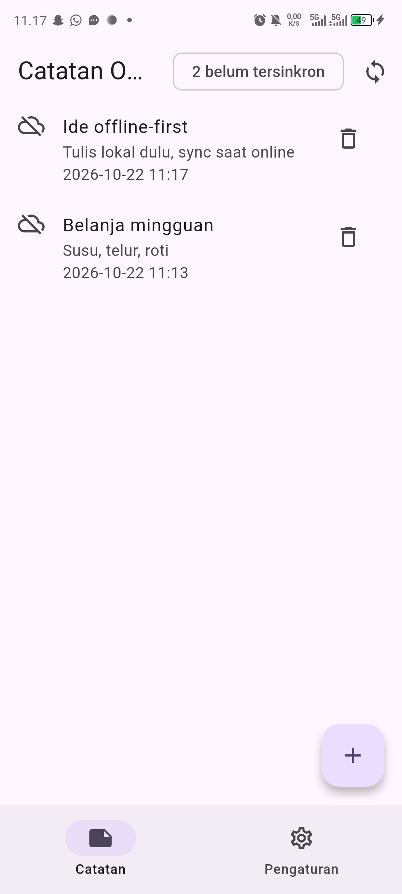
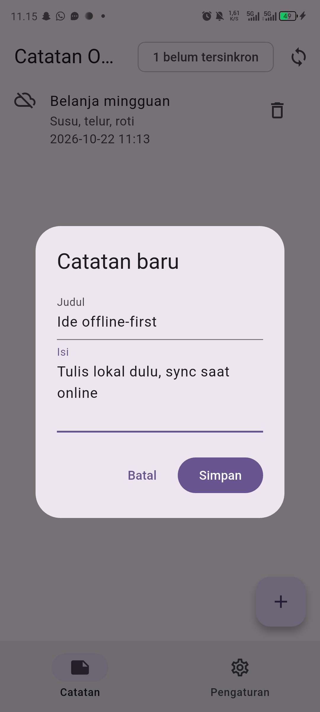
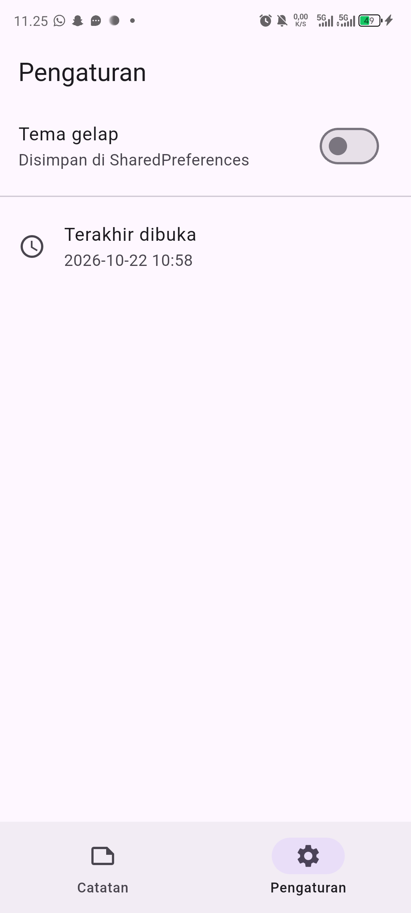
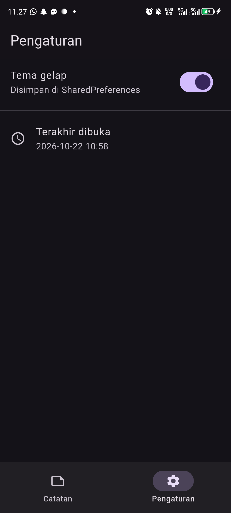
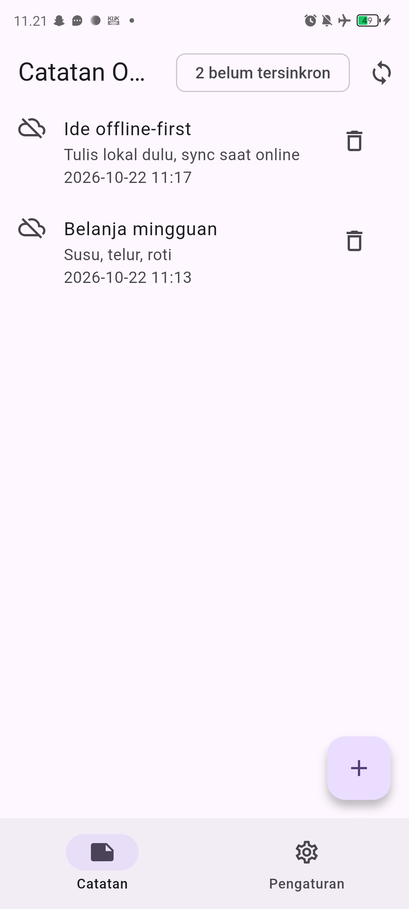
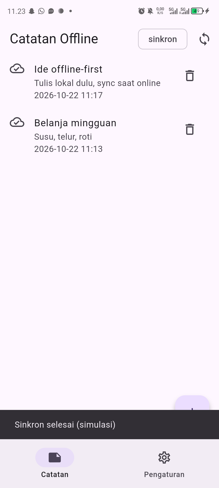

# Screenshots HP fisik (1080x2400)

Diambil langsung dari HP **Infinix X6739 (Android 14)** memakai build release
(`flutter build apk --release`) melalui `adb`, bukan golden test dan bukan
screenshot jendela desktop. Data dibuat lewat UI asli: dua catatan, mode pesawat
untuk kondisi dirty, sync, lalu toggle tema terang/gelap.

Golden test (`test/screenshot_test.dart` + `lib/screenshot_main.dart`) tetap
tersedia di `test/goldens/` sebagai regresi visual 390x844 @3x, tetapi tidak
dipakai sebagai gambar laporan.

## Galeri

| Daftar Catatan | Dialog Tambah |
| :---: | :---: |
|  |  |
| *Badge "2 belum tersinkron" + daftar catatan* | *Dialog "Catatan baru"* |

| Pengaturan Terang | Pengaturan Gelap |
| :---: | :---: |
|  |  |
| *Toggle tema mati* | *Toggle tema menyala* |

| Sebelum Sync | Sesudah Sync |
| :---: | :---: |
|  |  |
| *Dua catatan masih dirty (mode pesawat)* | *Semua catatan sudah sinkron* |

## Daftar File

- `01-notes-list.png` — daftar catatan + badge "2 belum tersinkron".
- `02-dialog-tambah.png` — dialog tambah catatan.
- `03-settings-terang.png` / `04-settings-gelap.png` — toggle tema.
- `05-dirty-sebelum.png` / `06-dirty-sesudah.png` — badge sebelum/sesudah sync.

Behavior identik dengan Week 5 (UI sama, struktur folder beda).

## Cara Capture Ulang di HP

1. Build release: `flutter build apk --release`.
2. Install: `adb install -r build/app/outputs/flutter-apk/app-release.apk`.
3. Buat dua catatan lewat FAB; capture `01` dan `02`.
4. Aktifkan mode pesawat, capture `05`; matikan mode pesawat, tekan sync,
   capture `06`.
5. Buka tab Pengaturan, capture `03`; nyalakan tema gelap, capture `04`.
6. Ambil gambar dengan `adb shell screencap -p /sdcard/nama.png` lalu
   `adb pull`.

`flutter run -t lib/screenshot_main.dart` hanya untuk preview web/golden
(repository seed in-memory), bukan sumber screenshot laporan.
