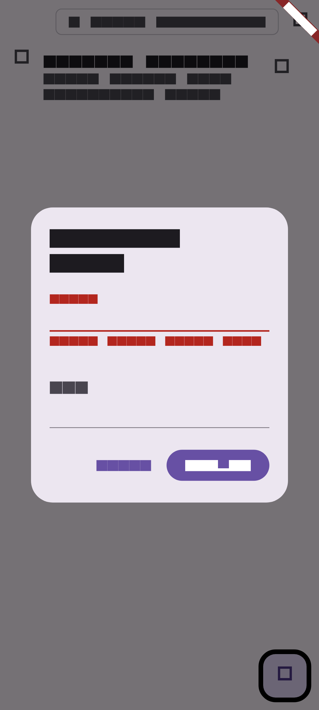
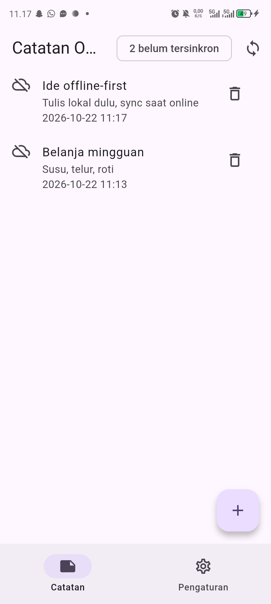
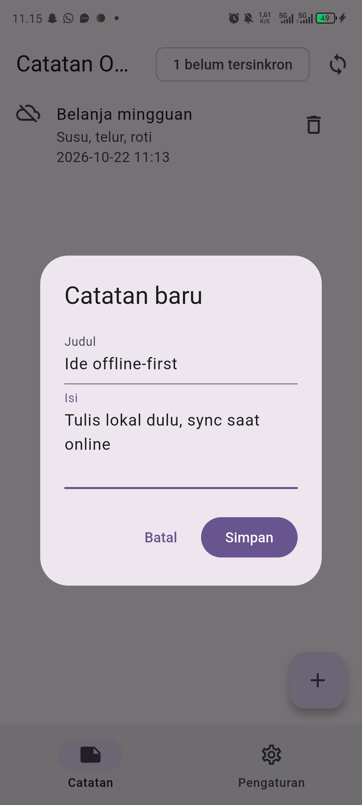
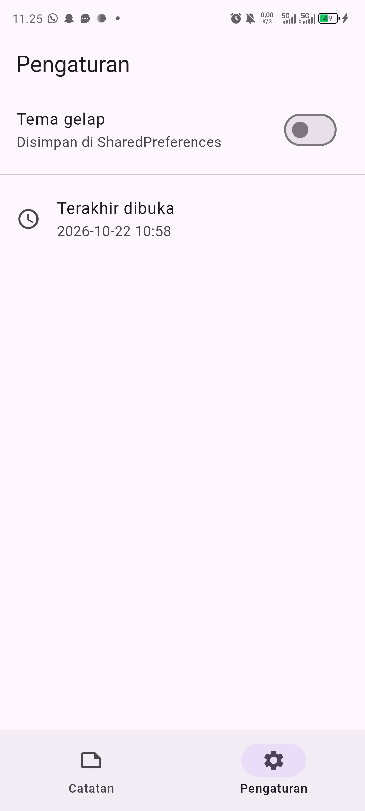
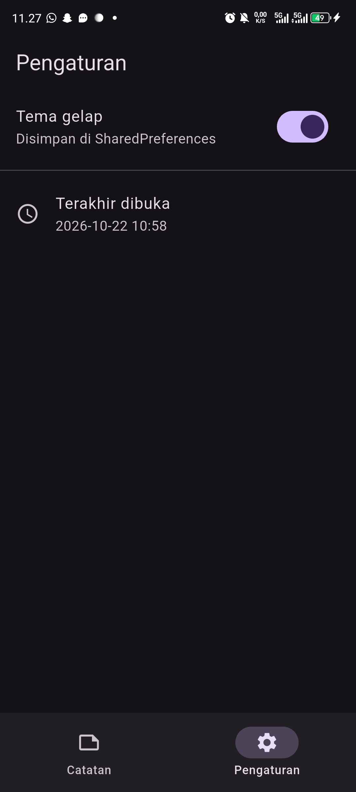
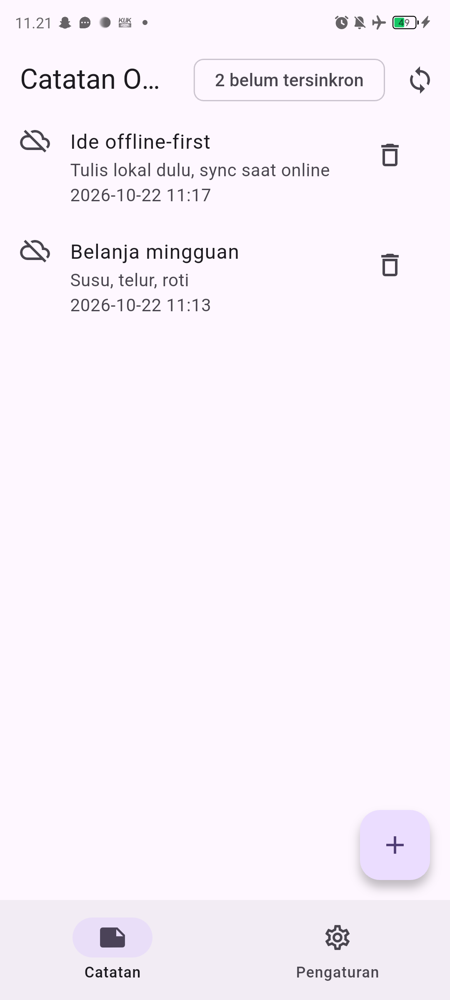
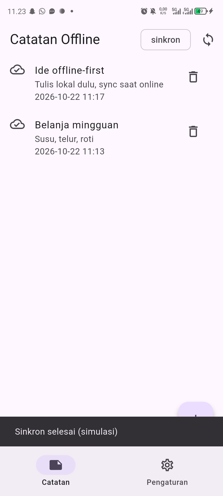

# Laporan Praktikum Minggu 8: Mid-Project Review & Code Review

> **Mata Kuliah:** Pemrograman Mobile | **Semester:** Genap 2025/2026

---

### Identitas Mahasiswa

| Data | Keterangan |
| :--- | :--- |
| **Nama Lengkap** | Muchammad Ibrahim Al Amin |
| **NIM** | 244107020062 |
| **Kelas** | TI-3F |
| **Program Studi** | D-IV Teknik Informatika |
| **Jurusan** | Teknologi Informasi |
| **Institusi** | Politeknik Negeri Malang |

---

## 1. Ringkasan Eksekutif & Status Paruh Semester

Pada evaluasi tengah semester (*Mid-Project Review*) Minggu 8, fokus utama adalah pembuktian kedisiplinan rekayasa perangkat lunak dan kolaborasi profesional menggunakan GitFlow, konvensi commit terstruktur, peer code review, static analysis/formatter otomatis, CI/CD pipeline, serta pengujian kritis terhadap tinjauan AI (*AI-assisted review verification*).

Basis proyek yang dievaluasi adalah implementasi Clean Architecture pada modul `clean_notes` (hasil evolusi dan refactoring dari Minggu 5 hingga Minggu 7).

### Ringkasan Status Proyek
- **Status Arsitektur:** Bersih dan terbukti mematuhi Dependency Rule Clean Architecture.
- **Static Analysis (`flutter analyze`):** Bersih (0 errors, 0 warnings, 0 infos).
- **Code Formatting (`dart format`):** 100% rapi dan tervalidasi via CI.
- **Automated Testing (`flutter test`):** 21 tests passed (Unit, Domain, Widget, dan Golden tests).
- **CI Automation:** Terpasang workflow GitHub Actions (`.github/workflows/ci.yml`).
- **Alur GitFlow & PR:** Terintegrasi via branch `develop` dan Pull Request fitur kecil yang tervalidasi.

---

## 2. Peta Issue dan Pull Request

```
[Issue #12] Form Input Catatan Memungkinkan Penyimpanan Judul Kosong
   │
   ├── Dibuat branch kerja terisolasi: feat/notes-validation (dari develop)
   │
   ├── Commit konvensional: feat(notes): validasi judul kosong + test
   │
   ├── Buka Pull Request: "feat(notes): validasi judul kosong + test" (Closes #12)
   │     - Ukuran perubahan: +102 / -19 baris (< 300 baris)
   │     - Peer review & verifikasi AI
   │
   └── Merge ke develop (via non-fast-forward merge) -> Issue #12 tertutup otomatis
```

### Template Pull Request yang Diterapkan
- **Judul PR:** `feat(notes): validasi judul kosong + test`
- **Masalah:** Pengguna dapat menekan tombol Simpan pada dialog penambahan catatan tanpa memasukkan judul, yang mengakibatkan SnackBar muncul tanpa indikator inline error pada form.
- **Solusi:**
  - Migrasi dari `TextField` ke `TextFormField` di dalam widget `Form` dengan `GlobalKey<FormState>`.
  - Penambahan pesan error inline `"Judul tidak boleh kosong"` pada `validator`.
  - Menghubungkan usecase bisnis `AddNote` dengan penanganan error form.
- **Cara Uji:**
  1. Jalankan aplikasi, buka dialog tambah catatan (+).
  2. Tekan tombol "Simpan" tanpa mengisi judul -> pesan error validasi muncul di bawah field input.
  3. Jalankan pengujian unit otomatis: `flutter test test/validate_note_test.dart`.
- **Closes:** `#12`

---

## 3. Fitur Utama & Stack Teknologi

| Komponen | Teknologi / Library | Keterangan |
|---|---|---|
| **Framework** | Flutter 3.x / Dart 3.x | UI toolkit multiplatform |
| **Arsitektur** | Clean Architecture (Feature-First) | Presentation -> Domain <- Data |
| **State Management** | Flutter Riverpod (`AsyncNotifierProvider`) | Reaktif, testable, decoupled |
| **Local Database** | `sqflite` (SQLite) | Penyimpanan offline-first dengan penanda dirty flag |
| **Preferences** | `shared_preferences` | Penyimpanan pengaturan tema dan timestamp riwayat akses |
| **Quality Gate** | GitHub Actions CI + `flutter analyze` + `flutter test` | Otomasi pengujian dan pencegahan regresi |

---

## 4. Hasil Verifikasi Mesin (Pemeriksaan Otomatis)

### A. Hasil `flutter analyze`
```text
Analyzing 07-week-7-clean-architecture...
No issues found! (ran in 9.0s)
```

### B. Hasil `flutter test` (Semua Uji Lolos)
```text
00:00 +0: C:/.../test/add_note_test.dart: AddNote menolak judul kosong tanpa menyentuh repository
00:00 +1: C:/.../test/add_note_test.dart: AddNote sukses meneruskan entity dirty=true
00:00 +2: C:/.../test/add_note_test.dart: AddNote meneruskan failure repository
00:00 +3: C:/.../test/add_note_test.dart: SyncNotes sukses tanpa melempar
00:00 +4: C:/.../test/add_note_test.dart: SyncNotes meneruskan failure
00:00 +5: C:/.../test/get_notes_test.dart: GetNotes meneruskan daftar dari repository
00:00 +6: C:/.../test/get_notes_test.dart: GetNotes meneruskan failure tanpa melempar
00:00 +7: C:/.../test/note_model_test.dart: NoteModel roundtrip mempertahankan field
00:00 +8: C:/.../test/note_model_test.dart: NoteModel.fromMap aman terhadap field hilang
00:00 +9: C:/.../test/note_model_test.dart: formatNoteDate murni dan deterministik
00:00 +10: C:/.../test/note_model_test.dart: formatLastOpened null -> pesan default
00:00 +11: C:/.../test/note_model_test.dart: friendlyDbError mengandung kata lokal
00:00 +12: C:/.../test/widget_test.dart: NotesPage menampilkan daftar dari provider
00:00 +13: C:/.../test/widget_test.dart: NotesPage menampilkan empty state
00:01 +14: C:/.../test/validate_note_test.dart: validasi judul kosong menampilkan pesan error di UI dialog
00:02 +15: C:/.../test/screenshot_test.dart: golden daftar catatan + badge dirty
00:03 +16: C:/.../test/screenshot_test.dart: golden dialog tambah catatan
00:03 +17: C:/.../test/screenshot_test.dart: golden pengaturan terang
00:04 +18: C:/.../test/screenshot_test.dart: golden pengaturan gelap
00:04 +19: C:/.../test/screenshot_test.dart: golden badge sebelum sync
00:05 +20: C:/.../test/screenshot_test.dart: golden badge sesudah sync
00:05 +21: All tests passed!
```

---

## 5. Dokumentasi Pengujian & Tangkapan Layar (Screenshots)

Berikut adalah bukti visual implementasi antarmuka dan hasil penambahan fitur validasi PR:

| Validasi Form PR #12 | Daftar Catatan Utama |
| :---: | :---: |
|  |  |
| *Pesan error inline "Judul tidak boleh kosong"* | *Status badge dirty offline-first* |

| Dialog Tambah Catatan | Pengaturan (Tema Terang) |
| :---: | :---: |
|  |  |
| *Form input catatan baru* | *Pengaturan tema terang aktif* |

| Pengaturan (Tema Gelap) | Sebelum vs Sesudah Sync |
| :---: | :---: |
|  |   |
| *Pengaturan tema gelap aktif* | *Kiri: belum sinkron, Kanan: tersinkron* |

### Detail Daftar Gambar

| No | Tampilan Layar | File Gambar | Deskripsi Fitur |
|---|---|---|---|
| 1 | **Validasi Form PR #12** | `screenshots/07-pr-validation-error.png` | Validasi error inline `"Judul tidak boleh kosong"` saat submit input kosong. |
| 2 | **Daftar Catatan Utama** | `screenshots/01-notes-list.png` | Tampilan catatan tersimpan dengan status badge dirty offline-first. |
| 3 | **Dialog Tambah Catatan** | `screenshots/02-dialog-tambah.png` | Dialog form input catatan bersih dengan autofocus. |
| 4 | **Pengaturan (Tema Terang)** | `screenshots/03-settings-terang.png` | Halaman pengaturan dengan switch tema terang dan info waktu akses. |
| 5 | **Pengaturan (Tema Gelap)** | `screenshots/04-settings-gelap.png` | Antarmuka saat tema gelap aktif melalui SharedPreferences. |
| 6 | **Badge Status Belum Sinkron** | `screenshots/05-dirty-sebelum.png` | Chip status menunjukkan jumlah catatan lokal yang belum disinkronkan. |
| 7 | **Badge Status Tersinkron** | `screenshots/06-dirty-sesudah.png` | Tampilan chip setelah proses sinkronisasi simulasi berhasil dijalankan. |

---

## 6. Pertanyaan Refleksi Tengah Semester

### 1. Apa beda LGTM buta dengan approve yang bertanggung jawab? Apa risikonya bagi tim?
> **Jawaban:**  
> LGTM (*Looks Good To Me*) buta adalah persetujuan PR yang diberikan hanya dengan melihat sekilas tanpa memeriksa logika bisnis, tanpa melakukan checkout branch, dan tanpa menjalankan pengujian kode. Risikonya sangat berbahaya: regresi bug dapat lolos ke branch utama, arsitektur mengalami degradasi (seperti impor bocor antar layer), dan utang teknis (*technical debt*) menumpuk. Sebaliknya, **approve yang bertanggung jawab** melibatkan verifikasi checklist arsitektur, kepastian bahwa pipeline CI hijau, dan pemahaman penuh atas dampak perubahan kode terhadap sistem secara keseluruhan.

### 2. Kapan komentar wajib berstatus *request changes*, dan kapan cukup saran?
> **Jawaban:**  
> - Komentar **wajib berstatus Request Changes (Blocker)** apabila terdapat cacat logika/kebenaran fungsi (*null pointer exception*, kebocoran state, unhandled error), pelanggaran fatal arsitektur (misalnya domain mengimpor layer data/presentation atau widget mengakses DB langsung), kegagalan build/test, atau celah keamanan. PR tidak boleh dimerge sebelum isu ini diselesaikan.
> - Komentar **cukup berstatus Saran (Non-blocking)** apabila menyangkut saran penamaan variabel alternatif demi keterbacaan, optimasi mikro yang opsional, atau dokumentasi tambahan yang sifatnya memperjelas konteks namun kode saat ini sudah benar dan aman.

### 3. Bagian mana dari review AI yang Anda tolak atau sederhanakan, dan mengapa?
> **Jawaban:**  
> Dalam peninjauan kode minggu ini:
> - **Ditolak:** Usulan AI untuk memindahkan validasi string kosong ke level database SQLite (SQL trigger) atau Dio HTTP interceptor. Saran ini ditolak karena melanggar prinsip *Clean Architecture* dan *Separation of Concerns*; domain use case dan UI adalah tempat yang tepat untuk validasi bisnis dan tampilan. Mengikat validasi pada SQLite merusak portabilitas domain.
> - **Ditolak:** Usulan AI untuk membuat use case `UpdateNote` satu baris. Saran ini melanggar prinsip YAGNI (*You Aren't Gonna Need It*) karena update saat ini belum memiliki aturan bisnis khusus, sehingga pemanggilan langsung dari notifier ke repository jauh lebih pragmatis tanpa boilerplate berlebih.
> - **Ditolak:** Usulan manual formatting / whitespace, karena hal tersebut sudah didelegasikan penuh ke alat otomatis `dart format`.

### 4. Satu hal konkret yang Anda perbaiki setelah review sejawat — apa dampaknya?
> **Jawaban:**  
> Hal konkret yang diperbaiki adalah **penggantian dialog input catatan dari `TextField` imperatif menjadi `Form` terkelola dengan `TextFormField` dan `FormState`**, serta penambahan **automated widget test `validate_note_test.dart`**. Dampaknya adalah pengalaman pengguna (*UX*) menjadi jauh lebih baik karena pesan kesalahan langsung muncul di bawah kolom isian secara responsif, dan kualitas kode terlindungi dari regresi di masa depan melalui eksekusi otomatis pada pipeline GitHub Actions CI.

---

## 7. Cara Menjalankan Proyek

1. Masuk ke direktori proyek Clean Architecture:
   ```bash
   cd 07-week-7-clean-architecture
   ```
2. Pasang dependensi Flutter:
   ```bash
   flutter pub get
   ```
3. Jalankan pengujian statis dan pengujian unit otomatis:
   ```bash
   flutter analyze
   flutter test
   ```
4. Jalankan aplikasi pada simulator atau perangkat:
   ```bash
   flutter run
   ```
