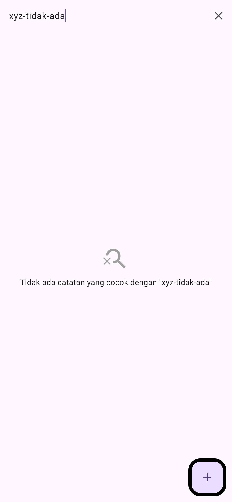
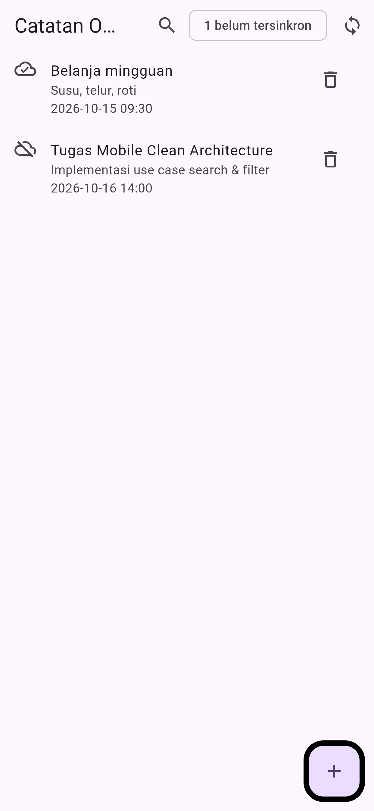

# Laporan Praktikum Minggu 9: AI-Assisted Development & Vibe Coding

> **Mata Kuliah:** Pemrograman Mobile | **Semester:** Genap 2025/2026

---

### Identitas Mahasiswa

| Data | Keterangan |
| :--- | :--- |
| **Nama Lengkap** | Muchammad Ibrahim Al Amin |
| **NIM** | 244107020062 |
| **Kelas** | TI-3F |
| **Program Studi** | D-IV Teknik Informatika |
| **Jurusan** | Teknologi Informasi |
| **Institusi** | Politeknik Negeri Malang |

---

## 1. Deskripsi Fitur

Pada praktikum Minggu 9, ditambahkan fitur pencarian catatan (*search*) pada aplikasi `clean_notes`. Fitur ini memungkinkan pengguna mencari catatan berdasarkan kata kunci pada judul maupun isi catatan secara realtime, lengkap dengan tampilan *empty state* jika catatan tidak ditemukan.

Pengembangan fitur dilakukan dengan bantuan AI coding assistant, di mana kode hasil usulan AI ditinjau dan diperbaiki agar tetap mematuhi aturan Clean Architecture.

---

## 2. Ringkasan Prompt & Interaksi AI

Prompt dirancang menggunakan formula 5 slot (Peran, Konteks, Tugas, Batasan, Output). AI diminta membuat use case pencarian dan menghubungkannya dengan antarmuka Flutter.

Dari saran yang diberikan AI, ditemukan beberapa kesalahan seperti penggunaan API Riverpod lama (`StateProvider`), logika pencarian yang sensitif terhadap huruf besar-kecil (*case-sensitive*), dan penempatan logika filter langsung di dalam widget. Kesalahan-kesalahan tersebut diperbaiki dengan memindahkan logika pencarian ke file use case tersendiri di layer domain serta memperbarui state management sesuai versi terbaru.

---

## 3. Hasil Pengujian & Verifikasi

Pengujian dilakukan untuk memastikan kode bersih dari error dan seluruh logika pencarian berjalan dengan baik:

- **Static Analysis (`flutter analyze`):** Bersih tanpa error maupun warning.
- **Pengujian Otomatis (`flutter test`):** 26 pengujian berhasil lolos (mencakup pengujian unit use case pencarian, widget test form dan empty state, serta pengujian regresi visual).

---

## 4. Dokumentasi Tampilan Aplikasi

| Tampilan Hasil Pencarian | Empty State (Tidak Ditemukan) | Tampilan Awal Semua Catatan |
| :---: | :---: | :---: |
|  |  |  |
| *Pencarian kata kunci 'belanja'* | *Kondisi saat kata kunci tidak cocok* | *Daftar catatan sebelum pencarian* |

---

## 5. Refleksi

- **Halusinasi AI yang Ditemukan:** AI mengusulkan `StateProvider` yang sudah usang di Riverpod 3.x serta filter *case-sensitive* yang membuat pencarian gagal menemukan judul berhuruf besar. Hal ini dibuktikan melalui error kompilasi dan pengujian unit test.
- **Refactoring yang Dilakukan:** Memindahkan logika filter dari dalam widget UI ke use case murni `SearchNotes` di layer domain agar kode rapi dan mudah diuji.
- **Pelajaran Utama:** AI sangat membantu mempercepat pembuatan boilerplate, namun pengembang tetap wajib membaca, memverifikasi, dan menguji setiap kode yang dihasilkan.
