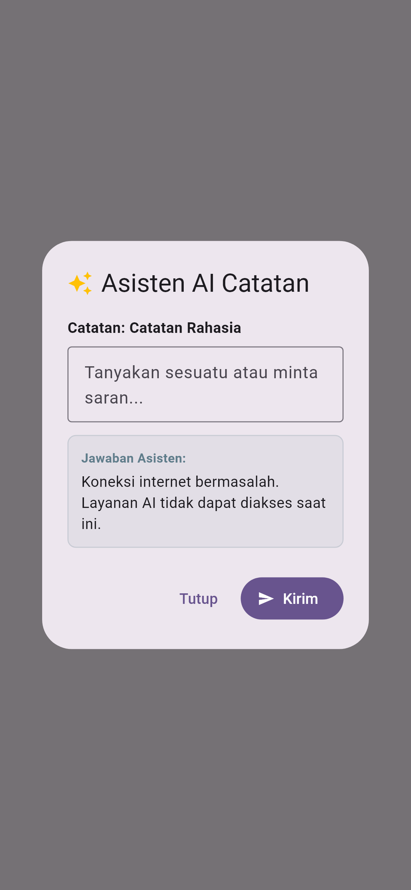

# Laporan Praktikum Minggu 10: Integrasi Fitur AI

> **Mata Kuliah:** Pemrograman Mobile | **Semester:** Genap 2025/2026

---

### Identitas Mahasiswa

| Data | Keterangan |
| :--- | :--- |
| **Nama Lengkap** | Muchammad Ibrahim Al Amin |
| **NIM** | 244107020062 |
| **Kelas** | TI-3F |
| **Program Studi** | D-IV Teknik Informatika |
| **Jurusan** | Teknologi Informasi |
| **Institusi** | Politeknik Negeri Malang |

---

## 1. Deskripsi Fitur

Pada praktikum Minggu 10, diimplementasikan integrasi kecerdasan buatan (AI) berbasis Large Language Model (Google Gemini) ke dalam aplikasi catatan mobile. Fitur ini dirancang untuk membantu pengguna merangkum isi catatan secara otomatis serta menyediakan asisten tanya-jawab interaktif langsung di dalam aplikasi.

Integrasi ini dilengkapi dengan mekanisme perlindungan data pribadi pengguna serta penanganan kondisi *offline* atau saat kuota API habis, sehingga pengguna tetap mendapatkan pengalaman yang baik dalam kondisi apa pun.

---

## 2. Pengujian & Verifikasi

Fitur telah melalui proses verifikasi dan pengujian otomatis untuk menjamin kehandalan sistem:

- **Static Analysis (`flutter analyze`):** Berhasil tanpa ada error atau peringatan pada kode.
- **Pengujian Fungsional (`flutter test`):** Berhasil menguji pemanggilan layanan AI, penyimpanan aman API key, respon otomatis, penanganan batasan kuota, serta mode *fallback* saat tidak ada koneksi internet.

---

## 3. Dokumentasi Tampilan Aplikasi

| Asisten AI Berhasil Merangkum Catatan | Penanganan Kondisi Offline / Fallback |
| :---: | :---: |
|  |  |
| *Tampilan dialog saat AI memberikan ringkasan* | *Tampilan ramah saat koneksi terputus* |

---

## 4. Refleksi

- **Pengalaman Pengguna (UX):** Menambahkan indikator proses saat AI memproses data sangat penting agar pengguna memahami bahwa sistem sedang bekerja dan aplikasi tidak macet (*freeze*).
- **Penanganan Kondisi Tak Terduga:** Memberikan pesan *fallback* yang jelas jauh lebih baik daripada membiarkan aplikasi *crash* atau menampilkan pesan error teknis yang membingungkan pengguna.
- **Keamanan Data:** Penyimpanan kunci otentikasi API secara terpisah memastikan keamanan kredensial aplikasi tetap terjaga.
