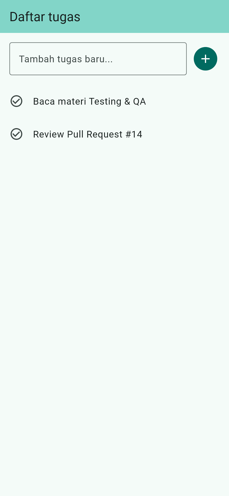
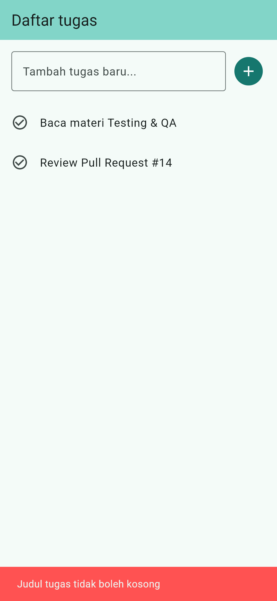
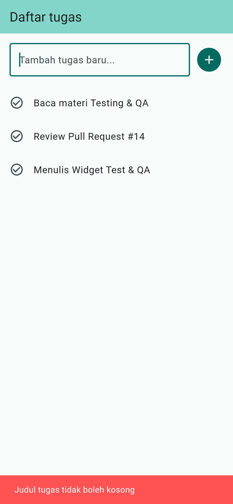

# Laporan Praktikum Minggu 12: Testing & Quality Assurance

> **Mata Kuliah:** Pemrograman Mobile | **Semester:** Genap 2025/2026

---

### Identitas Mahasiswa

| Data | Keterangan |
| :--- | :--- |
| **Nama Lengkap** | Muchammad Ibrahim Al Amin |
| **NIM** | 244107020062 |
| **Kelas** | TI-3F |
| **Program Studi** | D-IV Teknik Informatika |
| **Jurusan** | Teknologi Informasi |
| **Institusi** | Politeknik Negeri Malang |

---

## 1. Deskripsi Praktikum

Pada praktikum Minggu 12, dipelajari dan diimplementasikan strategi pengujian menyeluruh (*Quality Assurance*) pada aplikasi mobile Flutter. Pengujian mencakup tiga tingkatan utama untuk memastikan aplikasi bebas dari bug dan regresi:

1. **Pengujian Unit (*Unit Test*):** Menguji kebenaran aturan logika validasi teks serta kasus batas (*boundary conditions*).
2. **Pengujian Layanan (*Fake Repository Test*):** Menguji alur pengambilan dan penyimpanan data secara terisolasi menggunakan data tiruan (*fake repository*) tanpa bergantung pada koneksi internet atau database fisik.
3. **Pengujian Antarmuka (*Widget Test*):** Memverifikasi interaksi pengguna di layar, seperti validasi input kosong, pesan kesalahan, dan penambahan item ke dalam daftar.
4. **Pengujian Integrasi (*Integration Test*):** Memastikan keseluruhan alur kerja aplikasi berjalan baik dari awal hingga akhir.

---

## 2. Hasil Pengujian & Verifikasi

Semua pemeriksaan otomatis telah dijalankan dan berhasil dengan hasil bersih:

- **Static Analysis (`flutter analyze`):** Tidak ada masalah atau error yang ditemukan.
- **Pengujian Suite (`flutter test`):** Seluruh 12 pengujian lulus dengan sukses (4 unit test validasi, 4 test fake repository, dan 4 widget test interaksi).
- **Pengujian Integrasi (`integration_test/app_test.dart`):** Skenario penambahan tugas berhasil dieksekusi.
- **Cakupan Pengujian (*Code Coverage*):** File cakupan `coverage/lcov.info` berhasil digenerasi dan mencakup seluruh cabang logika penting aplikasi.

---

## 3. Dokumentasi Tampilan Aplikasi

| Tampilan Daftar Tugas | Pesan Validasi Input Kosong | Tugas Baru Berhasil Ditambahkan |
| :---: | :---: | :---: |\n|  |  |  |
| *Daftar tugas yang telah tersimpan* | *Peringatan jika input tidak valid* | *Kondisi setelah tugas baru disimpan* |

---

## 4. Refleksi

- **Pentingnya Pengujian Kasus Batas:** Pengujian batas (seperti spasi kosong atau panjang teks maksimum) sangat efektif mencegah data tidak valid masuk ke sistem tanpa disadari.
- **Peran Fake Repository:** Mengisolasi dependensi eksternal membuat proses pengujian berjalan jauh lebih cepat, stabil, dan tidak bergantung pada kondisi jaringan.
- **Nilai Widget Test:** Membantu memvalidasi respon antarmuka secara visual dan memastikan pesan kesalahan tampil tepat waktu kepada pengguna sebelum aplikasi dirilis.
